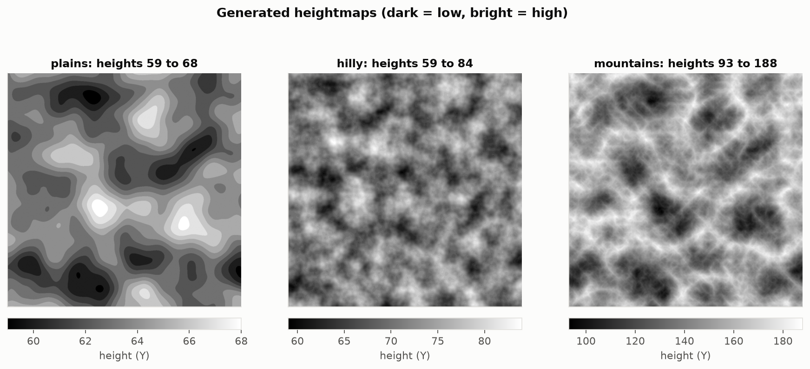
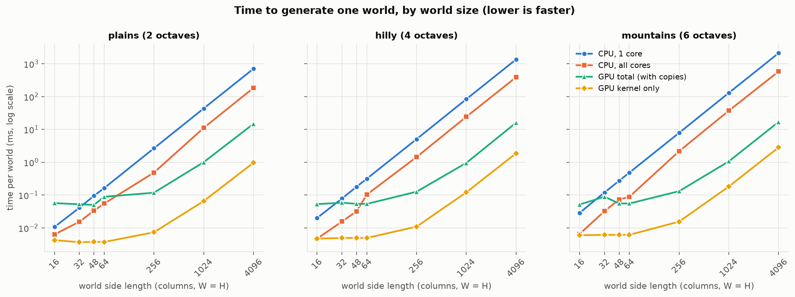
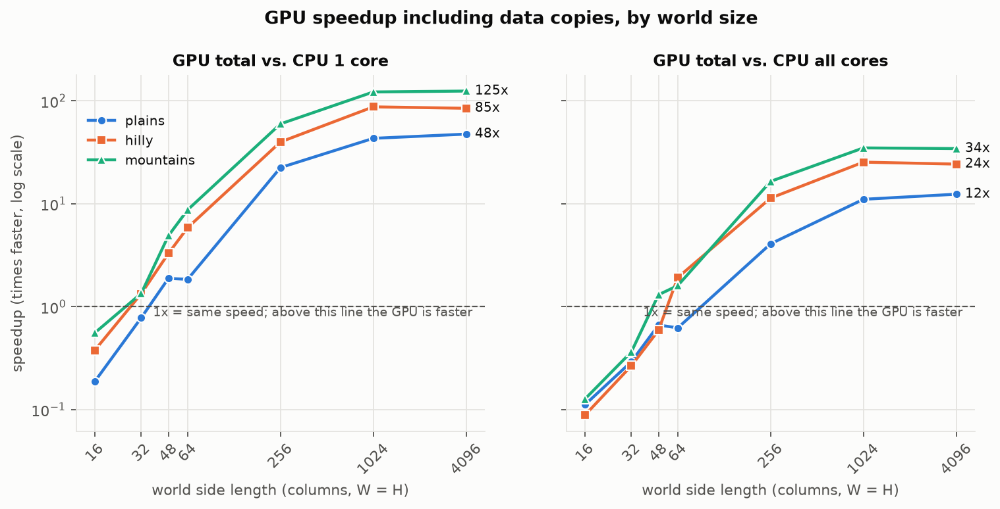
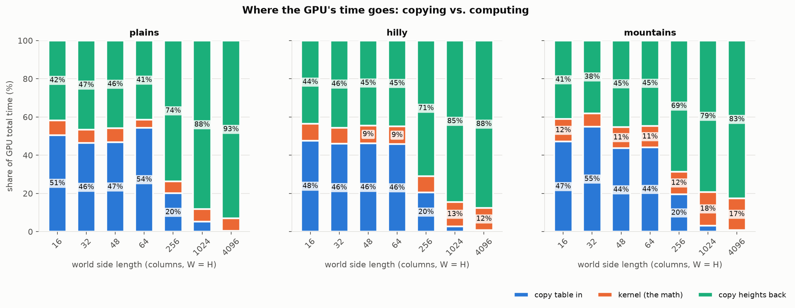
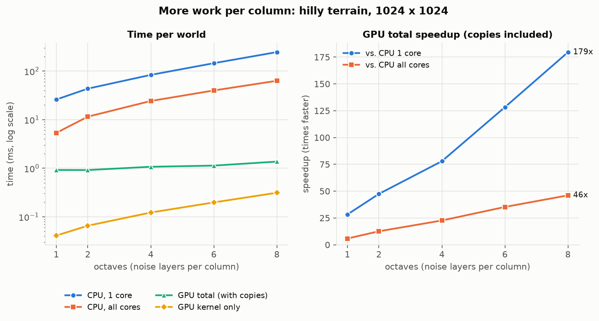
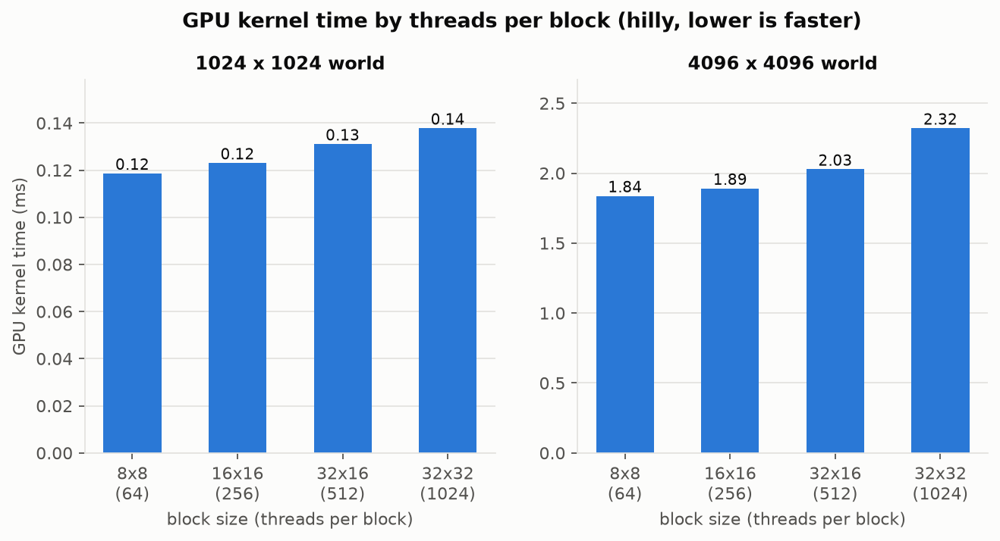

# CPU vs. GPU Terrain Generation: Measuring When CUDA Beats Sequential C++

**CEPARCO Integrating Project**

**Group members:** Matthew Fabregas, Kane Ibanez, Bowen Li, Jat Teoxon

- [Mid-project update (Milestone #2)](#mid-project-update-milestone-2-week-10): what is built and measured so far
---

# Mid-project update (Milestone #2, Week 10)

**Demo video:** _add link here_

The CPU version and the first CUDA version (lookup table in global memory) are working for all three terrain types. On our test PC the two versions produce identical heights in all 162 correctness cases. The GPU becomes faster than one CPU core at about 32 × 32 to 48 × 48 columns, and at 4096 × 4096 it is 48× to 125× faster with data copies included. Copying data, not the kernel, takes most of the GPU's time.

## 1. Milestone checklist

| Promised for Week 10 | Status |
|---|---|
| CPU version and first CUDA version (global memory) generate plains and hilly heightmaps | Done. Mountains also works. |
| CPU and GPU outputs match within tolerance on all edge-case sizes | Done. 162 of 162 cases pass with 0 columns different. |
| First CPU vs. GPU timings for at least three world sizes | Done for seven sizes and all three terrain types. |
| First version of the 3D viewer | Done (`viewer/viewer.py`). |

Done ahead of schedule: a multi-core (OpenMP) CPU version, the octave test (RQ2), the threads-per-block test (first half of RQ3), smoothness checks on every test case, and the graphs.

## 2. Test PC and build

| Item | Details |
|---|---|
| CPU | Intel Core i5-8400 @ 2.80 GHz (6 cores, 6 threads) |
| GPU | NVIDIA GeForce GTX 1660 SUPER (compute capability 7.5, 22 SMs, 6 GB) |
| RAM and OS | 16 GB, Windows 10 |
| Software | CUDA Toolkit 13.5, MSVC 19.51 (Visual Studio 2026), NVIDIA driver 617.42 |
| Build | Release, x64, `--fmad=false`, OpenMP on (6 threads), no fast-math |
| Timing | 1 warm-up run (thrown away) and 30 timed runs per case. We report the median. |

All results come from this one PC. The program writes these details to [`results/environment.txt`](results/environment.txt) on every run. Build steps are in [`SETUP.md`](SETUP.md).

**How to read the times.** "GPU total" is copying the lookup table in, running the kernel, and copying the heights back. "GPU kernel" is the math only. Speedup is the CPU median divided by the GPU median, and we always use GPU total unless we say "kernel only".

## 3. Results so far

### Generated terrain



| Type | Octaves | Lowest | Highest | Average | Steepest step | Limit | Clamped columns |
|---|---:|---:|---:|---:|---:|---:|---:|
| Plains | 2 | 59 | 68 | 63.18 | 1 | 2 | 0 |
| Hilly | 4 | 59 | 84 | 71.29 | 1 | 4 | 0 |
| Mountains | 6 | 93 | 188 | 148.29 | 3 | 8 | 0 |

These are 1024 × 1024 maps made by the GPU with the main seed. Every terrain type stays inside its smoothness limit. Across all 162 correctness cases the steepest step is 1 for plains, 1 for hilly and 4 for mountains.

As the proposal predicted, the terrain is flatter than the full B ± A range, because the noise layers partly cancel. Mountains sit high (average 148) because ridged noise is mostly positive. We have not retuned the numbers yet.

### RQ1: at what world size does the GPU become faster?





Hilly terrain (4 octaves), times in milliseconds:

| World | CPU 1 core | CPU 6 cores | GPU kernel | GPU total | vs 1 core | vs 6 cores | Faster |
|---|---:|---:|---:|---:|---:|---:|---|
| 16 × 16 | 0.0201 | 0.0047 | 0.0047 | 0.0531 | 0.4× | 0.1× | CPU |
| 32 × 32 | 0.0784 | 0.0156 | 0.0049 | 0.0585 | 1.3× | 0.3× | GPU vs 1 core only |
| 48 × 48 | 0.18 | 0.0320 | 0.0050 | 0.0542 | 3.3× | 0.6× | GPU vs 1 core only |
| 64 × 64 | 0.32 | 0.10 | 0.0049 | 0.0538 | 5.9× | 1.9× | GPU |
| 256 × 256 | 5.06 | 1.44 | 0.0109 | 0.13 | 39.9× | 11.4× | GPU |
| 1024 × 1024 | 83.5 | 24.2 | 0.12 | 0.95 | 87.6× | 25.4× | GPU |
| 4096 × 4096 | 1353 | 388 | 1.87 | 15.9 | 84.8× | 24.3× | GPU |

The smallest tested size where the GPU wins:

| Terrain | Against 1 CPU core | Against all 6 CPU cores |
|---|---|---|
| Plains (2 octaves) | 48 × 48 | 256 × 256 |
| Hilly (4 octaves) | 32 × 32 | 64 × 64 |
| Mountains (6 octaves) | 32 × 32 | 48 × 48 |

- **One Minecraft chunk (16 × 16) is too small for the GPU.** One CPU core is about 2 to 5 times faster there, because the GPU pays a fixed cost of about 0.05 ms per run for its two copies.
- **The more work per column, the earlier the GPU wins.** Mountains cross over sooner than plains.
- **The speedup levels off at large sizes.** From 1024 × 1024 to 4096 × 4096 it barely changes, because the copy back grows at the same rate as the CPU's work.
- At 4096 × 4096 the GPU total is 47.6× (plains), 84.8× (hilly) and 124.7× (mountains) faster than one core, and 12.4×, 24.3× and 34.4× faster than six cores.

Tables for plains and mountains are in [`results/summary.md`](results/summary.md).

### RQ4: how much of the GPU's time is copying data?

This also answers the reviewer's point on **full-height map transfer costs**.



One GPU run has three parts: copying the 512-byte lookup table to the GPU, running the kernel, and copying the whole height array back (4 bytes per column). We time each part separately with CUDA events.

| World (hilly) | Bytes copied back | Copy table in | Kernel | Copy heights back | GPU total | Copying share |
|---|---:|---:|---:|---:|---:|---:|
| 16 × 16 | 1,024 | 0.025 ms | 0.005 ms | 0.023 ms | 0.053 ms | 91.1% |
| 256 × 256 | 262,144 | 0.026 ms | 0.011 ms | 0.090 ms | 0.13 ms | 90.8% |
| 1024 × 1024 | 4,194,304 | 0.026 ms | 0.12 ms | 0.81 ms | 0.95 ms | 87.3% |
| 4096 × 4096 | 67,108,864 | 0.12 ms | 1.87 ms | 14.0 ms | 15.9 ms | 88.3% |

Copying takes 83% to 96% of the GPU's total time across all sizes and terrain types. The kernel is never the slow part.

- **Small worlds:** each copy costs about 0.025 ms no matter how little data it moves. Two copies give the GPU a floor of about 0.05 ms per run.
- **Large worlds:** the copy back grows with the number of columns, at about 5 GB per second. At 4096 × 4096 it moves 64 MB and takes 14 ms, while the kernel takes under 3 ms.
- **Effect on speedup:** for hilly at 4096 × 4096 the GPU is 85× faster than one CPU core with copies included, and about 725× faster counting the kernel alone. We report the first number as our main result, because a program that needs the heights on the CPU has to pay for the copy.

The host buffer is ordinary pageable memory.

### RQ2 (early result): octaves



Hilly terrain, 1024 × 1024, times in milliseconds:

| Octaves | CPU 1 core | CPU 6 cores | GPU kernel | GPU total | vs 1 core | vs 6 cores | Copying share |
|---:|---:|---:|---:|---:|---:|---:|---:|
| 1 | 26.0 | 5.34 | 0.0411 | 0.92 | 28.2× | 5.8× | 95.5% |
| 2 | 43.5 | 11.5 | 0.0656 | 0.92 | 47.4× | 12.6× | 92.8% |
| 4 | 83.5 | 24.2 | 0.12 | 1.07 | 77.9× | 22.6× | 88.6% |
| 6 | 145 | 39.9 | 0.20 | 1.13 | 128.3× | 35.3× | 82.5% |
| 8 | 246 | 63.1 | 0.31 | 1.37 | 179.5× | 46.1× | 77.2% |

Going from 1 to 8 octaves makes the CPU about 9 times slower but adds only 0.45 ms to the GPU total, so the speedup rises from 28× to 180×. More work per column favors the GPU because the copy cost stays the same.

### RQ3 (early result): threads per block



| World (hilly) | 8 × 8 (64) | 16 × 16 (256) | 32 × 16 (512) | 32 × 32 (1024) |
|---|---:|---:|---:|---:|
| 1024 × 1024, kernel | 0.12 ms | 0.12 ms | 0.13 ms | 0.14 ms |
| 4096 × 4096, kernel | 1.84 ms | 1.89 ms | 2.03 ms | 2.32 ms |

Smaller blocks are slightly faster for this kernel. At 4096 × 4096, 1024 threads per block is about 26% slower than 64. The effect on total time is small because copying dominates. The lookup-table memory test (global, constant, shared) is Week 13 work.

## 4. Points raised in the proposal review

### Full-height map transfer costs

Answered under RQ4 above.

### Floating-point agreement between CPU and GPU

Our proposal allowed a small tolerance: heights could differ by at most 1 on at most 0.01% of columns. We did not need it. The CPU and GPU outputs are identical.

| Check | Result |
|---|---|
| Test cases (9 sizes × 2 seeds × 3 origins × 3 terrain types) | 162 |
| Cases passed | 162 |
| Columns compared | 317,330,478 |
| Columns where CPU and GPU differ | 0 |
| Largest height difference | 0 |
| Cases where two GPU runs gave different output | 0 |

The outputs match exactly for four reasons:

- **Same code.** The CPU and the GPU kernel both call the same functions in `src/terrain.h`. There is no second copy of the formulas that could drift.
- **Same number type.** All of the noise math uses 32-bit `float` on both sides, and the final height is floored and clamped by the same code.
- **No fused multiply-add on the GPU.** By default the CUDA compiler merges `a * b + c` into one operation that rounds once instead of twice, which can change the last bit of a result. We compile with `--fmad=false` to turn this off. The program also checks this on the real GPU at start-up and writes the result to `results/environment.txt` ("GPU a*b+c merging : off"). The same check on the CPU also reports off.
- **No fast-math on the CPU.** The host compiler keeps its default strict floating-point rules.

The test origins include (1,000,000, -1,000,000), where `float` has fewer digits left for the fractional part of a coordinate. The terrain is coarser there, but the CPU and GPU lose the same precision in the same way, so they still match.

These results are for our test PC and build settings. Every case is listed in [`results/correctness.csv`](results/correctness.csv).

### Synchronization for partial blocks

A world whose width or height is not a multiple of 16 leaves some blocks only partly filled. The GPU still launches full 16 × 16 blocks, so some threads have no column to work on.

**What we do now (Week 10).** The height kernel uses one thread per column. Each thread reads the shared lookup table, computes one height, and writes one array slot that no other thread touches. Threads share no working data, so the kernel needs no `__syncthreads()` and no atomics. A thread outside the world is stopped by a bounds check (`if (x < W && z < H)`) and does nothing.

| World | Grid of blocks | Threads launched | Idle threads | Cases passed |
|---|---|---:|---:|---:|
| 1 × 1 | 1 × 1 | 256 | 255 | 18 of 18 |
| 3 × 3 | 1 × 1 | 256 | 247 | 18 of 18 |
| 2 × 100 | 1 × 7 | 1,792 | 1,592 | 18 of 18 |
| 100 × 2 | 7 × 1 | 1,792 | 1,592 | 18 of 18 |
| 15 × 17 | 1 × 2 | 512 | 257 | 18 of 18 |
| 17 × 5 | 2 × 1 | 512 | 427 | 18 of 18 |
| 255 × 257 | 16 × 17 | 69,632 | 4,097 | 18 of 18 |
| 1001 × 777 | 63 × 49 | 790,272 | 12,495 | 18 of 18 |
| 4097 × 4097 | 257 × 257 | 16,908,544 | 123,135 | 18 of 18 |

The test also proves the idle threads wrote nothing. Before each run the GPU array and 64 guard values after it are filled with a marker. After the run, every column must hold a real height and every guard value must be unchanged. All 162 cases pass both checks.

**What we will do in Week 13.** The statistics kernels (highest, lowest and average height, and steepest step) combine values inside each block using shared memory, and that does need `__syncthreads()`. Our rules for partial blocks:

- **No early return.** Every thread in a block must reach the same `__syncthreads()` calls. A thread outside the world therefore stays in the kernel instead of returning at the bounds check.
- **Neutral values.** A thread outside the world puts a value in shared memory that cannot change the answer: 0 for the sum and the steepest step, the smallest integer for the maximum, and the largest integer for the minimum. The reduction then runs over all 256 slots with no special case.
- **Between blocks.** Each block adds its result to the global result with atomic operations (`atomicAdd`, `atomicMax`, `atomicMin`).
- **Neighbors across block edges.** The steepest-step kernel runs after the height kernel has finished, so a neighbor in another block is read from the finished height array. A column at the world edge skips the neighbor that does not exist.

Heights are integers, so the sum, maximum and minimum do not depend on the order threads finish in. We expect the GPU statistics to match the CPU exactly and will test this on the same nine edge-case sizes.

## 5. Changes since the approved proposal

| Change | Why |
|---|---|
| Dropped the managed-memory comparison (`cudaMallocManaged` with and without prefetch) | Prefetching managed memory is not available on our Windows system (`results/environment.txt` reports it as not available). We use `cudaMalloc` and `cudaMemcpy`, which also lets us time each copy directly for RQ4. |
| Added a multi-core CPU version (OpenMP, 6 threads) | So the GPU is also compared against the whole CPU, not only one core. This was an "if we have time" item. |
| Added 32 × 32 and 48 × 48 to the benchmark sizes | The GPU starts winning between 16 × 16 and 64 × 64, and the proposal had no size in between. |
| 30 timed runs and medians, instead of 10 runs and averages | Small sizes take microseconds and are noisy. The CSV files still hold the average, minimum and standard deviation, and every single run. |
| The GPU is built with `--fmad=false` only, not `nvcc -O3 --fmad=false` | We use the Visual Studio CUDA project defaults (Release). |
| Tests change one setting at a time from a baseline | Instead of trying every combination of size, octaves and block size. |
| One-time GPU setup is reported separately | Start-up and `cudaMalloc` happen once and are not part of any timed run. |

## 6. Left for Week 13

- Constant-memory and shared-memory versions of the lookup table (second half of RQ3)
- GPU statistics: maximum, minimum and sum with atomics and with a shared-memory reduction, and the smoothness kernel, all checked against the CPU
- Retune the terrain numbers if we want taller or more varied terrain
- Final graphs, write-up and repo cleanup

## 7. Where everything is

| Path | What it is |
|---|---|
| `src/terrain.h`, `src/main.cu` | The terrain math, CPU and GPU versions, tests and timing |
| `viewer/viewer.py`, `viewer/plots.py` | 3D viewer and graph maker |
| [`results/summary.md`](results/summary.md) | Every result table in one place |
| `results/plots/` | The graphs and heightmap pictures |
| `results/*.csv` | Summaries and every single timed run |
| [`results/log_all.txt`](results/log_all.txt) | Everything the program printed on the run reported here |
| [`SETUP.md`](SETUP.md) | How to build and run |

## 8. Prior work we build on

We do not claim a new terrain algorithm. Our generator is built on published work, cited in full in the References at the end of the proposal:

- **Perlin (2002)**: the improved noise function (fade curve, gradients and permutation-table lookups) that our `noise()` is adapted from.
- **Green (2005)**: improved Perlin noise on a GPU with shaders, and the idea of sharing one permutation table between implementations so they give the same results.
- **Patel (2015)**: layering octaves and using ridged noise to shape terrain.
- **C2ME (n.d.)** and Minecraft itself: the motivation, and the 16 × 16 chunk and the Y = -64 to 319 height range.
- **NVIDIA CUDA C++ Programming Guide** and our course lectures: the thread, block and memory model.

## 9. AI usage declaration

We used the following AI tools in this project:

| Tool | What we used it for |
|---|---|
| Claude (Anthropic) | Reviewing the repo against the project requirements; verifying our C++ and CUDA syntax while refactoring the test harness, timing loop, and CSV output code in `src/main.cu`; writing `viewer/plots.py` and `SETUP.md`; drafting this mid-project update from our raw result files. |
| Gemini (Google) | Double-checking CUDA API and OpenMP #pragma syntax whenever we ran into compiler errors or unexpected behavior; helping us understand why CPU and GPU floating-point outputs slightly differed during early prototyping (which led us to specify --fmad=false in our proposal), and why PCIe memory transfers dominated our GTX 1660 SUPER runtime; generating initial 3D plotting boilerplate for viewer/viewer.py; refining and proofreading our Milestone #1 proposal and this update.|

The terrain math in `src/terrain.h` and the height kernel's design (one thread per column with a bounds check) were not changed by the Claude-assisted work above. All builds and measurements were run by the group on the test PC in section 2. The Week 13 kernels (constant and shared memory, and the statistics reductions) will be written by the group.

---

# Original proposal (Revised Milestone #1)

_Kept as approved. Where the project now differs, see section 5 of the update above._

## Abstract

In Minecraft, the world is made from a seed. For every (x, z) spot, or column, the game uses layered noise (similar to Perlin noise) to decide how high the ground is. Each column only needs its own coordinates, the seed, and a small lookup table, so every column can be worked out on its own. That is what makes it a good fit for parallel computing.

We will build a simple version of this that only makes the height of each spot: no caves, structures or villages. We will develop two versions of the terrain generator. which is sequential C++ version and a CUDA version that processes terrain columns in parallel. Both will be tested on the same computer to compare their performance. We will check that both give the same heights, then time them on different world sizes and terrain types (plains, hilly and mountains) to find out when the GPU actually becomes faster, and why.

## 1. Project Description

Minecraft generates terrain one 16 × 16 chunk (256 columns) at a time, and performance mods such as C2ME spread this work over several CPU cores. A chunk is a small job for a GPU, because launching a kernel and copying data has a fixed cost. But if we generate a large world at once, the GPU may end up faster than the CPU. We will not copy Minecraft's generator exactly. We use it as a reference to build our own heightmap generator and measure how it performs.

Our research questions are below. They may be adjusted as we learn more during our project creation.

1. **RQ1:** At what world size (16 × 16 up to 4096 × 4096 columns) does the GPU become faster than the CPU?
2. **RQ2:** How does the speedup change with the number of noise octaves and the terrain type?
3. **RQ3:** Does it matter where we keep the lookup table (global, constant or shared memory), and how many threads we put in each block?
4. **RQ4:** How much of the GPU's total time is just copying data to and from the GPU?

We also check that the terrain is smooth, meaning no sudden cliffs between neighboring columns.

### Inputs

Nothing is loaded from a file. Everything is set by numbers we type in:

| Input | Values |
|---|---|
| Seed | 64-bit integer. Default `3762183612631`. A second seed, `42`, is used in correctness tests. |
| World size (W × H columns) | See the size tables below. |
| World origin (x0, z0) | (0, 0) by default. Tests also use (-5000, 3000) and (1000000, -1000000) for negative and far-away coordinates. |
| Terrain type | Plains, hilly, or mountains (see section 2). |
| Octaves | Default per terrain type. For RQ2 we also try 1, 2, 4, 6 and 8 octaves on the hilly type. |
| Block size | 16 × 16 (256 threads) by default. For RQ3 we also try 8 × 8, 32 × 16 and 32 × 32. |

**A note on the last two rows.** Using more octaves creates more details in the terrain, while fewer octaves produces smoother terrain. The number of octaves also affects the computation time. Block size doesn't change the terrain at all. It only changes how the threads are grouped: many small groups or a few big ones.

**Benchmark sizes** (used for timing, from one Minecraft chunk up to a Large world):

| Test | World size | Columns | Chunks (16 × 16) |
|---|---:|---:|---:|
| One chunk | 16 × 16 | 256 | 1 |
| Tiny | 64 × 64 | 4,096 | 16 |
| Small | 256 × 256 | 65,536 | 256 |
| Medium | 1024 × 1024 | 1,048,576 | 4,096 |
| Large | 4096 × 4096 | 16,777,216 | 65,536 |

**Edge-case sizes** (used for correctness and bounds checking). All the benchmark sizes are multiples of 16, so they never leave a partly filled block. These test whether our bounds check actually works:

| Size | Why |
|---|---|
| 1 × 1, 3 × 3 | Smaller than one block. A 1 × 1 world has no neighbors. |
| 2 × 100, 100 × 2 | Very thin: one side smaller than a block, the other very long. |
| 15 × 17, 17 × 5 | One side smaller than a block and one side larger. |
| 255 × 257 | Just under and just over a multiple of 16. |
| 1001 × 777 | An odd-sized world that isn't square. |
| 4097 × 4097 | One past the largest benchmark size. |

### Outputs

- A saved heightmap for each run, plus a grayscale picture of it
- A rotatable 3D terrain viewer (Python, using the saved heights shrunk to about 512 × 512), colored from blue (low) to red (high). It is not part of any timing.
- The run time of the CPU version and the GPU version (GPU kernel time, and total GPU time including copying data)
- A check that the CPU and GPU outputs match, and a smoothness report per terrain type
- The speedup, saved in a CSV file and shown in graphs for RQ1 to RQ4

## 2. What we will parallelize and how

This part describes which parts of the program can run in parallel, and how we split the work between many workers instead of one doing all the calculations.

| Step | CPU (sequential) | GPU (CUDA) |
|---|---|---|
| 1. Height of every column | Nested loop over all columns | One kernel, one thread per column |
| 2. Max, min and sum of heights | One loop over the height array | Reduction kernel (atomics, and a shared-memory version) |
| 3. Smoothness check | One loop comparing each column to its right and lower neighbor | One kernel, then the same reduction |

In step 1, each column's result does not depend on any other column, so they can all be done at the same time. 

Step 2 finds the highest point, the lowest point, and the total of all the heights. Using atomic operations allows multiple GPU threads to update the same result safely, but it may reduce performance due to contention. So we also try a shared-memory version: the threads are split into groups (blocks), each group finds its own highest, lowest and total, and then we combine the group answers.

Step 3 checks if the terrain is smooth by comparing each column to its neighbors. Each column needs its neighbors' heights to already exist, so this only starts after all the heights are generated.

### Our plan for the GPU version

- **One thread per column.** Each thread works out which column it owns from its block number and its position in the block. We launch enough blocks to cover the whole world, rounding up. Some threads in the last blocks fall outside the world, so each thread first checks `if (x < W && z < H)` and does nothing if it is outside. The odd edge-case sizes test this. Each GPU thread calculates the height of one terrain column. Threads outside the world boundaries are skipped using a bounds check.
- **Same function on CPU and GPU.** We write the height function once with `__host__ __device__`, so both versions run the same math. 
- **Permutation table.** We build it once on the CPU from the seed (512 bytes) and copy it to the GPU. We test three places to keep it: global, constant and shared memory. Constant memory is fast when all threads read the same spot, but our threads read different spots, so we treat it as something to test, not as a sure speedup. Both versions use this same table, which is built on the CPU, so their outputs match and the comparison is fair.
- **Block size.** We test 64, 256, 512 and 1024 threads per block (8 × 8, 16 × 16, 32 × 16, 32 × 32).
- **Max, min and sum.** First version: every thread uses `atomicMax`, `atomicMin` and `atomicAdd` on one value. Second version: each block combines its own values in shared memory (waiting with `__syncthreads()` until the whole block is done), then writes one result with one atomic. Our lecture says many atomics on one spot slow things down, so we expect the second version to be faster, which is why we will test that.
- **Data transfer.** We compare copying the data ourselves (`cudaMalloc` and `cudaMemcpy`) with letting CUDA do it (`cudaMallocManaged`, with and without prefetch). The heights stay on the GPU while steps 2 and 3 run. We copy the full height array back only to compare with the CPU or to save it.
- We follow the CUDA thread, block and memory model from the CUDA C++ Programming Guide (NVIDIA, n.d.) and our lecture.

### The terrain formulas

The CPU and GPU versions use the same formulas and numbers. Only the way they run is different: the CPU goes through the columns one at a time, and the GPU gives each column its own thread.

**A. Seed and permutation table.** The seed is a 64-bit number. We use it to start a pseudo-random generator, then use that to shuffle the numbers 0 to 255 into a lookup table (the permutation table). The same seed always gives the same table. The table is built once on the CPU and copied to the GPU, so both versions use the identical table. We repeat it to 512 entries so lookups don't need to wrap around.

```text
rng = mt19937_64(seed)
p = [0, 1, 2, ..., 255]
for i = 255 down to 1:  j = rng() mod (i + 1);  swap(p[i], p[j])
perm[i] = p[i mod 256] for i = 0..511
```

We use a Fisher-Yates shuffle. We start from the end of the list and swap each number with a randomly chosen number from the part of the list before it. The random numbers come from `mt19937_64`, a standard C++ generator that gives the same numbers for the same seed on any computer. This way, if other group members run the code, they get the exact same terrain, so our results can be compared fairly. 

**B. 2D Perlin noise (adapted from the improved version, Perlin 2002).**

Perlin noise uses gradient vectors at grid points to generate smooth terrain values. The values from the surrounding corners are interpolated to calculate the height of each terrain column. Imagine graph paper where every crossing has an arrow chosen from the permutation table. To get a value for a point, we look at the four crossings (corners) around the square it sits in. Each one pushes the value a little depending on how the point lines up with its arrow, then we blend the four pushes smoothly into one number. The fade curve keeps the blending smooth, so there are no sharp edges between squares. More octaves add small bumps on top, like rocky features. The result is a value between about -1 and 1. Nearby points give nearby values, so neighboring columns get similar heights.

```text
fade(t)       = 6t^5 - 15t^4 + 10t^3
lerp(t, a, b) = a + t * (b - a)
grad(h, x, z), using h mod 8:
  0: x     1: -x     2: z     3: -z
  4: x+z   5: -x+z   6: x-z   7: -x-z

noise(x, z):
  xi = floor(x); zi = floor(z)
  X = xi AND 255; Z = zi AND 255
  xf = x - xi; zf = z - zi
  u = fade(xf); v = fade(zf)
  aa = perm[perm[X] + Z]       ba = perm[perm[X+1] + Z]
  ab = perm[perm[X] + Z + 1]   bb = perm[perm[X+1] + Z + 1]
  return lerp(v, lerp(u, grad(aa, xf, zf),   grad(ba, xf-1, zf)),
                 lerp(u, grad(ab, xf, zf-1), grad(bb, xf-1, zf-1)))
```

The result is a smooth value between about -1 and 1. Nearby inputs give nearby outputs, so neighboring columns get similar heights.

**C. Octaves and terrain height.** Octaves combine multiple noise layers with different frequencies and amplitudes. Lower frequencies generate large terrain features, while higher frequencies add smaller details. The first layer is the big smooth shape, and each layer after it has twice the detail (lacunarity 2.0) and half the strength (persistence 0.5). We add the layers together, so we get a big hill with small bumps on it. Mountains also use **ridged** noise, which flips each layer so the places where the noise is near 0 become sharp ridges. With a low base frequency, we expect this to give long mountain ranges instead of random spikes.

```text
fbm(xw, zw):
  sum = 0; amp = 1; freq = f0
  for o = 0 .. N-1:
    n = noise(xw*freq + 17.37*o, zw*freq + 31.91*o)   // sample one zoom level
    if ridged: n = 1 - 2 * abs(n)                      // flip into sharp ridges
    sum += amp * n                                     // add it, scaled by its strength
    freq = freq * 2.0; amp = amp * 0.5                 // next layer: 2x detail, half strength
  return sum * invNorm   // invNorm = 1 / (2 * (1 - 0.5^N)), keeps it near -1 to 1

xw = x0 + x;  zw = z0 + z
h  = clamp( floor( B + A * fbm(float(xw), float(zw)) ), -64, 319 )
```

Recent Minecraft versions have a world 384 blocks tall, from Y = -64 to Y = 319 ("Minecraft height limit 2026", n.d.), so we use that as our height limit. The three terrain types only differ in these settings (B = base height, A = amplitude in blocks, f0 = base frequency, N = octaves):

| Type | Noise | B | A | f0 | N | Height range (B ± A) | Smoothness limit |
|---|---|---:|---:|---:|---:|---|---|
| Plains | normal | 64 | 8 | 0.004 | 2 | 56 to 72 | ≤ 2 blocks |
| Hilly | normal | 72 | 24 | 0.008 | 4 | 48 to 96 | ≤ 4 blocks |
| Mountains | ridged | 100 | 90 | 0.004 | 6 | 10 to 190 | ≤ 8 blocks |

Smoothness limit means the largest height difference between two neighboring columns. These limits are our targets, checked at each terrain type’s normal number of octaves (plains 2, hilly 4, mountains 6). If a terrain type goes over its limit during testing, we adjust its numbers and report it. The 1 to 8 octave test for RQ2 is only about timing.

We will also look at the heightmap picture and the highest and lowest heights to make sure each terrain type looks like its name (plains flat, hilly rolling, mountains tall and ridged). Since we are adding several layers of noise together, the highs and lows of different layers can partly cancel each other out, so the terrain may come out flatter than we expect, like a plain with a few bumps. If that happens, for example if the mountain features get washed out, we will adjust the numbers. Patel (2015) says to expect this kind of hand-tuning when generating terrain from noise.

**D. Precision, rounding and clamping.**

- All the noise math uses 32-bit `float` on both the CPU and GPU, so they do the same kind of math. Heights are whole numbers (`int`), and totals are 64-bit because a big world adds up to more than a normal `int` can hold.
- We round down with `floorf`, then convert to `int`. We use floor because it handles negative heights the same way every time. Heights are clamped to [-64, 319], and we report how many columns were clamped (expected 0).
- Our CPU and GPU should give exactly the same heights. We still allow a 1 block difference in case of tiny rounding differences, but we expect 0.
- To keep both sides doing the same math, the GPU is compiled with `nvcc -O3 --fmad=false` and the CPU is built in Release mode without fast-math. These settings are shortcuts that make a number round a little differently, so we turn them off.
- For the grayscale picture only, a height h is scaled to 0 to 255 using `round(255 * (h - hmin) / (hmax - hmin))`. There can be up to 384 different heights but only 256 grays, so a few heights may share a gray. If hmax = hmin, the picture is all one gray. This is just for display and is not part of the comparison.

**E. Statistics.** We compute `hmax` (highest column), `hmin` (lowest column), `hsum` (all heights added up) and the average height. For smoothness, each column gets `d = max(|h(x,z) - h(x+1,z)|, |h(x,z) - h(x,z+1)|)`, which is how much its height differs from the neighbor next to it and the neighbor behind it. We only use neighbors that exist, so a 1 × 1 world has d = 0. We report `dmax` (the steepest spot) and the average d.

### What will not be parallelized

- **Building the permutation table from the seed.** It's only 256 values and is done once on the CPU. We build it the same way for both versions so the CPU and GPU get the same output, which makes comparing and testing on other computers easier.
- **Allocating memory and copying data between the CPU and GPU.** This includes copying the permutation table to the GPU. It's part of the GPU's total time, so we measure it separately (RQ4).
- **Saving files, the 3D viewer, comparing CPU and GPU results, the timing statistics, the CSV file and the graphs.** These only help us check and show the results. They are not what we are measuring.

**If we have time:** a multi-core (OpenMP) CPU version as an extra reference, grass/dirt/stone layers per column, a simple "snowy" color for high ground, and a 3D-printed model of a small piece of the terrain. These are not part of the main scope or the milestones. Caves, structures and blending between terrain types are out of scope.

## 3. Related studies

Green (2005) already ran improved Perlin noise on a GPU using shaders, and the result exactly matched the CPU version, so GPU noise is not new. The chapter also says the permutation table can be shared between implementations so they give the same results, which is what we do by building our table once and copying it to the GPU.

For Minecraft, the C2ME mod speeds up chunk generation by using more CPU cores (C2ME, n.d.).

Patel (2015) is a tutorial that uses the same octave and ridged-noise approach as ours, and notes that noise alone has no large-scale features like rivers.

### How ours is different

The existing GPU noise work targets shading and texturing in graphics APIs (mostly 3D noise), and C2ME targets multi-core CPUs. Our project uses CUDA to generate a whole heightmap and focuses on measuring: the world size where the GPU wins, the effect of work per column, memory type and block size, and the cost of copying data. We report both kernel time and total time including transfers, and we use the same PC for the CPU and GPU. We do not claim a new terrain algorithm.

Minecraft does not say why it generates terrain on the CPU, but we think there are a few reasons. The world is made in small 16 × 16 chunks, which is not much work for a GPU, and the results have to go back to the CPU anyway for things like mobs and collisions. Structures also have a lot of `if` conditions, which GPUs handle badly because threads that take different paths slow each other down. Servers may also have no GPU. These are possible reasons for using CPU-based terrain generation. Our project will investigate whether CUDA becomes more efficient when the number of generated terrain columns increases.

## 4. Our setup

| Item | Details |
|---|---|
| CPU | Intel Core i5-8400 (6 cores, 6 threads) |
| GPU | NVIDIA GeForce GTX 1660 Super (Turing, compute capability 7.5, 22 SMs, 1,408 CUDA cores, 6 GB) |
| RAM and OS | 16 GB, Windows 10 |
| Software | Visual Studio and CUDA Toolkit (versions to be added after installation), NVIDIA driver 617.42 |
| Languages | C++ (CPU version), CUDA C++ (GPU version), Python (viewer and graphs only) |

All results come from this one PC, so the CPU and GPU are compared on the same machine. Google Colab is not used for any reported result. If we ever test on another machine, its results go in a separate table.

## 5. How we will test and measure

- The CPU and GPU versions run the same seed, terrain type and world size, one after the other on the same PC.
- We time the CPU with `std::chrono` and the GPU with CUDA events. We report kernel time (just the GPU math) and total time (copy to GPU, kernels, copy back).
- Each test has one warm-up run, which we throw away, and then 10 timed runs. We report the average, the minimum and the standard deviation.
- Speedup = CPU average time / GPU average time. We always say whether it uses kernel time or total time.

**Correctness checks** (run on every edge-case size, both seeds (3762183612631 and 42) and all three origins):

| Check | Pass criterion |
|---|---|
| Heights, CPU vs GPU | Largest difference ≤ 1 block and at most 0.01% of columns different. We expect 0 and will report the real numbers. |
| Max, min, sum, smoothness (GPU vs CPU on the same heights) | Exactly equal (integers) |
| Two GPU runs, same input | Identical heights |
| Smoothness | `dmax` of each terrain type ≤ its limit in section C |

## 6. Schedule and mid-project milestone

| Week | Objectives |
|---|---|
| Week 7 | Milestone #1: Revised proposal |
| Week 10 | Milestone #2 (mid-project demo): The CPU version and the first CUDA version (global memory) both generate heightmaps for the plains and hilly terrain types, and their outputs match within our tolerance (section 5) on all the edge-case sizes. We have our first CPU vs. GPU timings for at least three world sizes. A first version of the 3D viewer is used to check that the heights look like terrain, so we can adjust the noise numbers. |
| Week 13 | Milestone #3 (final submission and demo): A polished, working project for all three terrain types (including mountains) and all five world sizes. This includes the constant and shared memory versions, the octave and block-size tests, the statistics and smoothness checks, all correctness tests passed, the results CSV and graphs, the write-up, and the finished GitHub repo. |

## References

C2ME. (n.d.). *Concurrent chunk management engine* [Mod]. CurseForge. https://www.curseforge.com/minecraft/mc-mods/c2me

Green, S. (2005). Implementing improved Perlin noise. In M. Pharr (Ed.), *GPU Gems 2* (pp. 409–416). Addison-Wesley. https://developer.nvidia.com/gpugems/GPUGems2/gpugems2_chapter26.html

Minecraft height limit 2026 – How high can you build? (Y=-64 to 319). (n.d.). BlockMosaic. https://mcimagetool.com/blog/minecraft-height-limit/

NVIDIA Corporation. (n.d.). *CUDA C++ programming guide*. https://docs.nvidia.com/cuda/cuda-c-programming-guide/

Patel, A. J. (2015). *Making maps with noise functions*. Red Blob Games. https://www.redblobgames.com/maps/terrain-from-noise/

Perlin, K. (2002). Improving noise. *ACM Transactions on Graphics, 21*(3), 681–682. https://doi.org/10.1145/566654.566636
